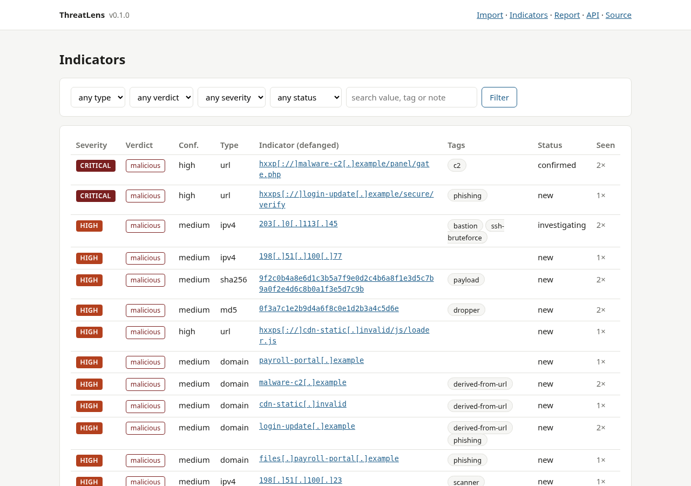
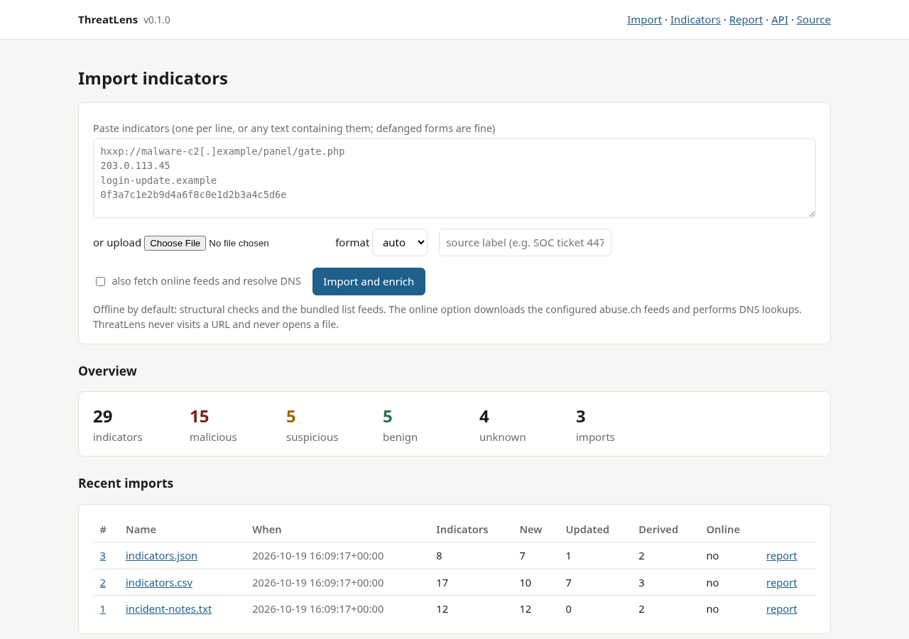
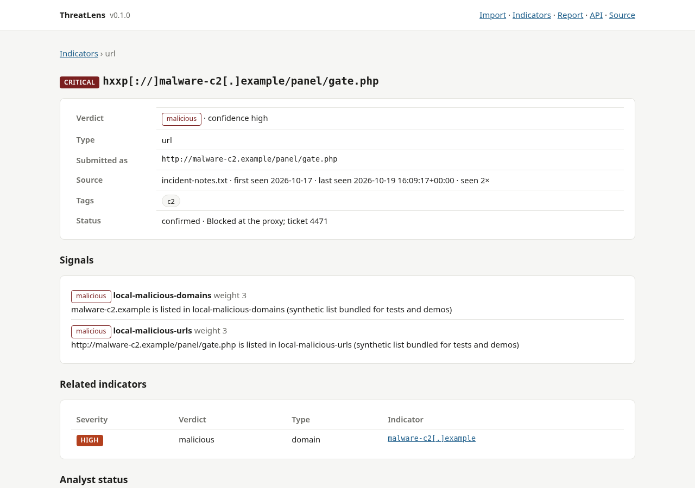

# ThreatLens

[](https://github.com/Leonard-Opasanjo/threatlens/actions/workflows/ci.yml)
[](pyproject.toml)
[](LICENSE)

ThreatLens turns a pile of indicators of compromise into an investigation. Paste or upload IP addresses, domains,
URLs and file hashes, in CSV, JSON or any text (defanged forms like `hxxp://evil[.]example` included), and it
normalises them, removes duplicates, pivots URLs to their hosts, enriches each one from configurable sources,
gives it a verdict, a severity and a confidence, keeps everything in a database across imports, and exports a
defanged investigation report.

It is offline by default: structural checks and local list feeds need no network. Downloading the configured
public feeds and resolving DNS are opt-in. ThreatLens never visits a URL and never opens a file, whatever it is
told about them.



## Contents

- [Purpose](#purpose)
- [Objectives](#objectives)
- [Safety rules](#safety-rules)
- [What happens to an indicator](#what-happens-to-an-indicator)
- [Sources](#sources)
- [Scoring](#scoring)
- [See it running](#see-it-running)
- [Install](#install)
- [Usage](#usage)
- [The investigation report](#the-investigation-report)
- [Architecture](#architecture)
- [Tests and continuous integration](#tests-and-continuous-integration)
- [Limitations](#limitations)
- [Roadmap](#roadmap)
- [About this project](#about-this-project)
- [Licence](#licence)

## Purpose

Indicators arrive from everywhere: a partner's spreadsheet, an EDR alert, a ticket, a pasted paragraph of
incident notes with the dots replaced by `[.]` so nobody clicks them. Before an analyst can act on them they need
to be in one shape, counted once, checked against what is already known, and ranked so the one that matters is at
the top. Doing that by hand across formats is slow and error-prone; doing it with a script that happens to fetch
the URL to "see what it is" is how an analyst's own machine becomes the next victim.

ThreatLens is the unglamorous middle of threat intelligence: the intake, normalisation, enrichment and scoring
step, done carefully, with a memory, and with a report at the end that can be shared without being dangerous.

## Objectives

1. **Accept anything and make it uniform.** CSV with any reasonable column names, JSON lists or objects, plain
   lists, or free text; refang defanged forms; classify into seven types; normalise so the same indicator
   written three ways is one record.
2. **Count once, remember always.** Duplicates within an import collapse; an indicator seen in an earlier import
   is updated, not recreated, with first and last seen and a count.
3. **Enrich from sources you choose.** Structural heuristics, bundled list feeds, your own list files, trusted
   public feeds (abuse.ch) when you allow a download, DNS when you allow a lookup.
4. **Score and explain.** Every indicator gets a verdict, severity and confidence derived from a stated table,
   and every signal that fed the score is kept and shown.
5. **Pivot.** A submitted URL also yields its host as an indicator, linked both ways, so the analyst sees the
   domain's or address's other appearances.
6. **Report safely.** The Markdown report defangs every indicator and includes a recommended action per verdict.

## Safety rules

- **No visits.** ThreatLens never issues a request to an indicator. URLs are parsed, matched and defanged; they
  are not fetched, not even for a HEAD request, not even to check whether they are alive.
- **No file handling.** Hashes are strings. Nothing is downloaded, opened or executed.
- **Offline unless told otherwise.** With no flag or checkbox, the only data used is what ships in the package
  and what you put in `feeds/`. The online option does exactly two things: downloads the feeds listed in
  `feeds.json` that have a `url` (abuse.ch lists by default, cached for a day), and resolves DNS for domains and
  reverse DNS for addresses. A lookup reaches a resolver, which an attacker running authoritative DNS could
  notice; that is why it is off by default.
- **Defanged out, refanged in.** Reports, the CLI and the dashboard show `hxxp` and `[.]`; input accepts both.
- **Bundled lists are synthetic.** The malicious feeds in the package use reserved names (`.example`,
  `.invalid`) and documentation address ranges so that tests and demos never touch anything real.

## What happens to an indicator

```
input (CSV / JSON / text / paste / upload)
   │  refang, classify (ipv4, ipv6, domain, url, md5, sha1, sha256), normalise, dedupe
   ▼
Indicator ──► host derived from URL (linked as related)
   │
   ▼  Enricher: every source returns Signals (verdict, weight, note)
   structural ─ list feeds (local and, if online, fetched) ─ DNS (if online)
   │
   ▼  score(): verdict, severity, confidence, reasons
Store: upsert by (type, value), signals replaced, import batch recorded
   │
   ▼  dashboard (filter, pivot, status, notes) · CLI · investigation report (defanged)
```

Normalisation: domains are lower-cased with the trailing dot removed; URLs keep scheme, host, port, path and
query, drop the fragment and lower-case the scheme and host; hashes are lower-cased and typed by length;
addresses are parsed with the standard library, so `999.1.1.1` is not an IP and `2001:db8::1` is.

## Sources

| Source | Needs network | What it contributes |
|---|---|---|
| `structural` | no | Address class (private, documentation, reserved); punycode labels; deep nesting; abused top-level domains; machine-generated-looking labels; URLs with a raw IP host, credentials before `@`, uncommon ports, executable file names, excessive length; link shorteners |
| local list feeds | no | Exact matches for addresses, URLs and hashes; domain matches that include subdomains; URL hosts checked against address and domain lists; an allow-list of well-known services that yields a benign verdict |
| online list feeds | yes (opt-in) | The same matching against feeds downloaded from the URLs in `feeds.json` (abuse.ch URLhaus and Feodo Tracker by default), cached for 24 hours |
| `dns` | yes (opt-in) | Informational: what a domain resolves to, the reverse record of an address |

Feeds are configured in `threatlens/feeds/feeds.json`. Each entry has a `name`, a `kind` (`ip`, `domain`, `url`,
`hash`), a `verdict` it contributes (`malicious` or `benign`), a `weight`, and either a `path` (local file) or a
`url` (fetched only online). Files are plain text, one entry per line, `#` comments, and hosts-file syntax is
understood. Point `--feeds` at your own configuration to use your organisation's lists.

## Scoring

| Verdict | Condition | Severity | Confidence |
|---|---|---|---|
| malicious | listed in at least one malicious feed (weight 3+) | critical if two or more feeds agree, else high | high if two feeds agree or heuristics also fire, else medium |
| benign | allow-listed and not in a malicious feed | info (low if heuristics also fired) | high (medium if heuristics fired) |
| suspicious | heuristic weight of 3 or more | medium | medium if two sources, else low |
| suspicious | heuristic weight 1 or 2 | low | low |
| unknown | nothing matched | info | low |

A malicious verdict always needs a list match: heuristics alone never exceed suspicious. Benign means the domain
is a well-known service, which says nothing about a specific URL on it; the full URL is still checked against the
URL feeds.

## See it running

The bundled CSV mixes list hits, heuristic hits, private and documentation addresses, hashes and well-known
services:

```
$ threatlens analyse threatlens/samples/indicators.csv
threatlens/samples/indicators.csv: 17 indicators (7 malicious, 5 suspicious, 2 benign, 3 unknown)
  critical malicious  high   url    hxxp[://]malware-c2[.]example/panel/gate.php  [local-malicious-domains, local-malicious-urls]
  high     malicious  medium domain files[.]payroll-portal[.]example  [local-malicious-domains]
  high     malicious  medium domain login-update[.]example  [local-malicious-domains]
  high     malicious  medium domain malware-c2[.]example  [local-malicious-domains]
  high     malicious  medium ipv4   203[.]0[.]113[.]45  [local-malicious-ips]
  high     malicious  medium md5    0f3a7c1e2b9d4a6f8c0e1d2b3a4c5d6e  [local-malicious-hashes]
  high     malicious  medium sha256 9f2c0b4a8e6d1c3b5a7f9e0d2c4b6a8f1e3d5c7b9a0f2e4d6c8b0a1f3e5d7c9b  [local-malicious-hashes]
  medium   suspicious low    domain akq9x2mz7vbh3qp[.]top  [structural]
  medium   suspicious low    url    hxxps[://]cdn-assets-update[.]xyz/dl/setup.exe  [structural]
  low      suspicious low    domain cdn-assets-update[.]xyz  [structural]
  low      suspicious low    domain xn--pple-43d[.]com  [structural]
  low      suspicious low    url    hxxp[://]198[.]51[.]100[.]200/a.php  [structural]
  info     benign     high   domain google[.]com  [allowlist-domains]
  info     benign     high   domain update[.]microsoft[.]com  [allowlist-domains]
  info     unknown    low    ipv4   10[.]0[.]1[.]77  [-]
  info     unknown    low    ipv4   192[.]0[.]2[.]10  [-]
  info     unknown    low    ipv4   198[.]51[.]100[.]200  [-]
```

The 14 submitted rows became 17 indicators because three URL hosts were derived. `malware-c2.example` is critical
because the URL list and the domain list both name it; `akq9x2mz7vbh3qp.top` is suspicious on two heuristics;
`google.com` is benign; the private address is unknown with a note saying why a feed match would be meaningless.

Load the three sample files and open the dashboard:

```bash
threatlens demo
threatlens serve            # http://127.0.0.1:8000
```



Each indicator shows its signals, its related indicators (the URL it came from, or the URLs on this host) and an
analyst status with a note:



## Install

Python 3.11 or newer.

```bash
git clone https://github.com/Leonard-Opasanjo/threatlens.git
cd threatlens
python -m venv .venv && . .venv/bin/activate
pip install -e ".[dev]"
```

Docker:

```bash
docker build -t threatlens .
docker run -d -p 127.0.0.1:8000:8000 -v threatlens-data:/data threatlens
docker run --rm -v "$PWD:/work" threatlens threatlens analyse /work/indicators.csv --report /work/report.md
```

## Usage

### Command line

```
threatlens analyse FILE [--online] [--feeds FEEDS.json] [--report FILE.md] [--json FILE.json]
threatlens import FILE [--source LABEL] [--online] [--feeds FEEDS.json] [--db PATH] [--report FILE.md]
threatlens list [--db PATH] [--verdict V] [--type T]
threatlens demo [--db PATH]
threatlens serve [--host H] [--port P] [--db PATH]
```

`analyse` is stateless: it prints the scored indicators (defanged) and optionally writes the report and JSON.
`import` stores the batch, so later imports update what is already known and the report for a batch can be
regenerated from the dashboard. Exit code 2 means the file could not be read or contained no indicators.

### Dashboard

```bash
threatlens serve [--host 127.0.0.1] [--port 8000] [--db threatlens.db]
```

The import page takes pasted text or an uploaded file (5 MB limit), a source label, and the online checkbox. Each
import gets a page with its indicators and a report link. The indicators page filters by type, verdict,
severity, status and free text. An indicator's page shows its signals, related indicators and a status form
(`new`, `investigating`, `confirmed`, `false_positive`, `closed`) with a note. `/api/indicators`,
`/api/indicators/{id}` and `/api/stats` return JSON; `/report.md` and `/report.json` export everything.

## The investigation report

Markdown, per import or for the whole database: a summary by verdict and severity; a table of indicators that
need action (malicious and suspicious) with severity, confidence, type, the defanged value, the sources that
flagged it and its analyst status; a detail section per such indicator with every signal, the recommended
action for its verdict and the analyst's note; a table of benign and unknown indicators; and a method-and-limits
section that states what the verdicts mean. Indicators inside source notes are defanged too.

## Architecture

```
threatlens/
├── ioc.py        Indicator; refang/defang; classify; normalise; extract from text; CSV/JSON/text importers; dedupe
├── enrich.py     Signal, Score; Structural, ListFeed (+ load_feeds with opt-in fetch and cache), Dns; Enricher; score()
├── db.py         SQLite store: imports, indicators (unique per type+value), signals, status; related-indicator lookup
├── report.py     Markdown investigation report (defanged) and JSON export
├── web.py        FastAPI dashboard and API
├── cli.py        analyse / import / list / demo / serve
├── feeds/        feeds.json and the bundled synthetic lists plus the allow-list
├── samples/      indicators.csv, indicators.json, incident-notes.txt
└── templates/    dashboard pages
tests/            35 tests, all offline (online fetch and DNS are tested through injected functions)
```

Design decisions:

- **Classification before everything.** Nothing enters the store without passing `classify`, so the type is
  certain and the value canonical. The importers only decide which strings to try.
- **Sources are small objects with one method.** `signals(indicator) -> list[Signal]`. Adding a source is a class
  and a line; the enricher does not know what the sources are.
- **Scoring is a table, not a model.** The rules in `score()` fit on a screen and are reproduced in this README.
  An analyst can predict the verdict from the signals.
- **Online is a parameter, not a mode.** The same code path runs with or without the network; the difference is
  which sources are in the list. Tests inject a fake fetcher and resolver.
- **Derived hosts are first-class.** A URL's host is stored as its own indicator with a link, so the question
  "what else have we seen on this host" has an answer.
- **Defang at the edges.** Values are stored canonical and refanged; every display and export defangs.

## Tests and continuous integration

```bash
ruff check .
pytest                                    # 35 tests, offline
bandit -q -c pyproject.toml -r threatlens
pip-audit
```

The tests cover classification of every type and a list of non-indicators, refang and defang, extraction from
prose, the three importers against the sample files, each structural heuristic, feed matching including
subdomains and URL hosts, the opt-in fetch with its cache, the DNS source with an injected resolver, the scoring
table row by row, the store's deduplication across imports, derived hosts, related lookups, filters and status,
the report's defanging and structure, and the dashboard and CLI end to end including a file upload and the size
limit.

CI runs the suite on Python 3.11, 3.12 and 3.13, builds and smoke-tests the Docker image (including the demo
import inside the container), and runs [SecureFlow](https://github.com/Leonard-Opasanjo/secureflow-devsecops)
with results in the Security tab.

## Limitations

- Enrichment is as good as the lists. Out of the box the malicious lists are synthetic; real coverage comes from
  enabling the abuse.ch feeds or adding your own. There is no reputation API integration (VirusTotal and the like
  need keys and have terms; a `Source` class is the place to add one).
- Heuristics produce false positives by design: a content delivery host with a random-looking label, a
  legitimate service on an uncommon port. They never produce a malicious verdict on their own.
- Only four kinds of online activity are possible (two feed downloads and two DNS lookup types), and none by
  default. There is no passive DNS, WHOIS or certificate transparency lookup yet.
- The dashboard has no authentication and binds to localhost.
- Imports over a few thousand indicators are fine; the store is SQLite and the enrichment is in-process, so
  hundreds of thousands would be slow.

## Roadmap

- STIX 2.1 and MISP export; OpenIOC and STIX import.
- WHOIS and certificate-transparency sources, and passive DNS where an organisation has access.
- Expiry: indicators age out of "malicious" when the feed that listed them stops doing so.
- Bulk status changes and CSV export from the filtered list.
- A watch mode that re-enriches the store on a schedule and reports verdict changes.

## About this project

ThreatLens is the fifth in a series of open-source security tools I am building to show practical security
engineering: [LogSentinel](https://github.com/Leonard-Opasanjo/logsentinel) finds the attack in the logs,
[SecureFlow](https://github.com/Leonard-Opasanjo/secureflow-devsecops) stops vulnerabilities before they ship,
[VulnScope](https://github.com/Leonard-Opasanjo/vulnscope) checks what the world can see,
[SecOps Copilot](https://github.com/Leonard-Opasanjo/secops-copilot) puts a language model to work on the
investigation without handing it the keys, and ThreatLens is where the indicators from all of them end up.

Issues and pull requests are welcome; [CONTRIBUTING.md](CONTRIBUTING.md) explains how to add a source or a
heuristic.

## Licence

MIT. See [LICENSE](LICENSE).
